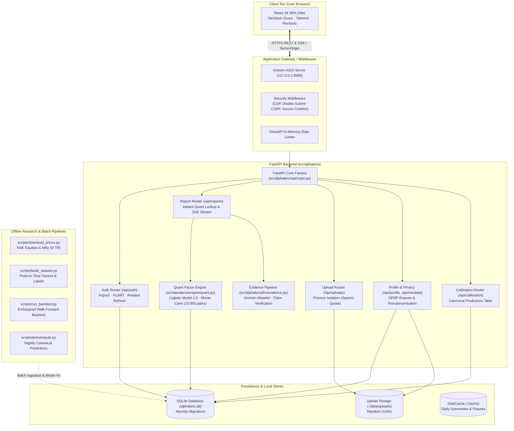
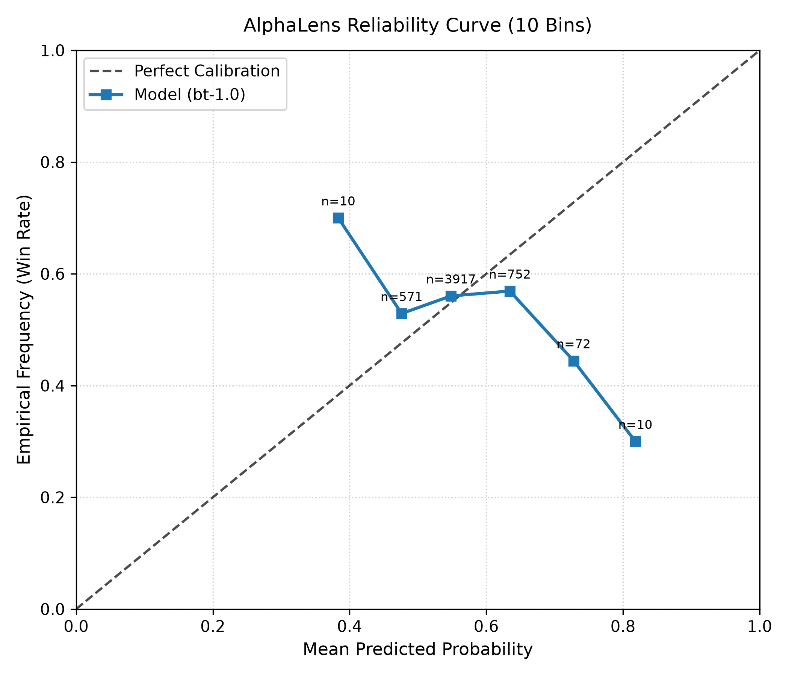
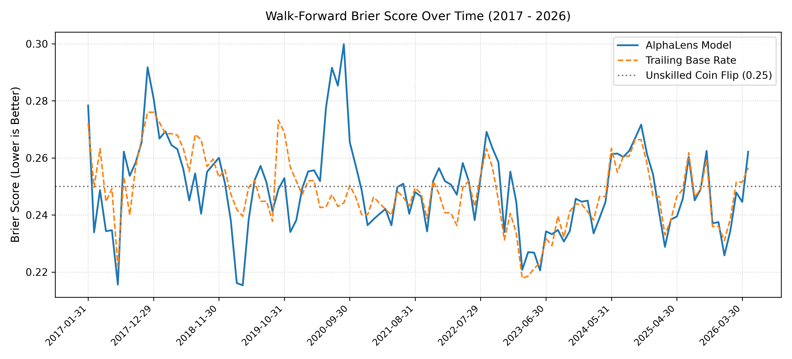
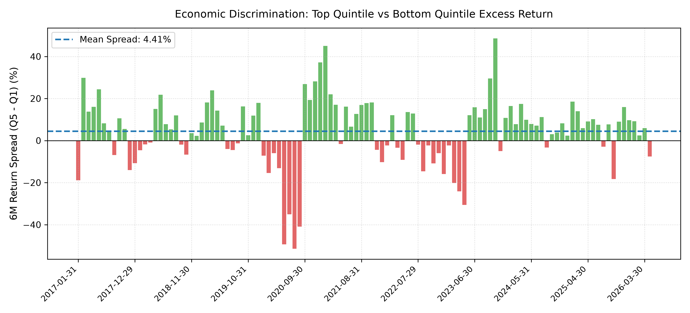

# AlphaLens: Calibrated, Evidence-Cited Equity Research Assistant (NSE India)

[](LICENSE)
[](pyproject.toml)
[](frontend/package.json)
[](https://fastapi.tiangolo.com)
[](tests/)

> **Disclaimer:** **Research and educational purposes only, not investment advice.**  
> AlphaLens is an academic and quantitative research tool exploring point-in-time cross-sectional factor modeling and probabilistic calibration on the National Stock Exchange of India (NSE). It does not provide personalized investment advice, financial planning, or portfolio management services under SEBI (Research Analysts) Regulations, 2014.

---

## 1. What is AlphaLens?

AlphaLens is an equity research platform designed specifically for the Indian equity market (NSE). Its core quantitative objective is evaluating:

$$P(\text{Stock's 6-month Total Return} > \text{Nifty 50 Total Return})$$

The foundational design principle is **strict decoupling of decision and evidence**:
1. **Calibrated Quant Engine**: Pure multi-factor logistic model trained with a strict walk-forward embargo protocol. The statistical model autonomously computes probabilities, factor attributions, and economic spreads.
2. **Generative LLM Layer**: Exclusively surfaces, contextualizes, and verifies source citations (corporate filings, disclosures) without modifying numerical probabilities or decision labels.

---

## 2. Key Empirical Results

All metrics below are computed from our **10-year walk-forward backtest** (`2017-01-31` to `2026-11-12`) across 119 monthly rebalance dates and recorded in [reports/backtest/results.json](file:///c:/Users/vishw/Desktop/project/reports/backtest/results.json):

| Metric | AlphaLens Model (6 Factors) | Momentum Baseline (`mom_12_1`) | Trailing Base-Rate Baseline |
| :--- | :---: | :---: | :---: |
| **Brier Score** (lower is better) | **0.2492** | 0.2482 | 0.2479 |
| **Brier Skill Score (BSS)** vs Base Rate | **-0.0051** | -0.0009 | 0.0000 |
| **Log Loss** | **0.6920** | 0.6896 | 0.6891 |
| **ROC AUC** | **0.5142** | 0.5055 | N/A\* |
| **Top vs Bottom Quintile Spread (6M Excess)** | **+4.41%** | +3.78% | N/A |
| **Spread $t$-statistic (Naive)** | **$t = 2.84$** ($p = 0.0054$) | $t = 2.90$ ($p = 0.0045$) | N/A |
| **Spread $t$-statistic (Newey-West HAC, lag 5)** | **$t = 1.79$** ($p = 0.0761$) | $t = 1.62$ ($p = 0.1071$) | N/A |
| **Common Sample Predictions (Resolved)** | **5,332** | 5,332 | 5,332 |
| **Total Rebalance Months** | **119** (112 resolved) | 119 (112 resolved) | 119 (112 resolved) |

\* *Footnote on Base-Rate Baseline ROC AUC: Base-rate predictions are constant across assets within each monthly cross-section, making ROC AUC undefined / non-applicable (N/A).*

- **Honest Statistical Interpretation**:
  - **No Calibration Skill**: Probabilities are **not** better calibrated than the trailing base rate ($BSS \approx 0$). They must be treated strictly as relative rank scores rather than physical probabilities.
  - **Marginal Factor Add over Momentum**: The 6-factor model adds very little over single-factor momentum alone (spread of +4.41% vs +3.78%, AUC 0.5142 vs 0.5055).
  - **Autocorrelation & HAC Significance**: Accounting for 6-month overlapping return windows sampled monthly via Newey-West HAC (lag 5), the spread $t$-statistic drops from naive $t=2.84$ ($p=0.0054$) to **$t=1.79$ ($p=0.0761$)**, which is only marginally significant at the 10% level and fails standard 5% significance.
- **Latency**: Sub-100ms Tier-1 response time (**mean 80.68 ms**, $p95 = 92.76\text{ ms}$).

---

## 3. System Architecture



---

## 4. Visualizations & Interface

### Calibration Reliability Curve


### Walk-Forward Brier Score Trajectory


### Top vs Bottom Quintile Excess Return Spread


---

## 5. Security & Privacy Controls

- **DPDP Act (India 2023) Compliance**:
  - **Explicit Consent**: Required notice checkbox on document uploads, logged immutably in `consent_records`.
  - **Right to Erasure**: `DELETE /api/me/data` wipes user data and files atomically, replacing audit references with a permanent `pseudo_id`.
- **Parser Hardening**:
  - Isolated worker subprocess using `multiprocessing.get_context("spawn")` with a 10s strict timeout, 20 MB file cap, and 200 MB storage quota.
- **SSRF & Network Defense**:
  - `SafeHttpClient` with custom DNS pre-resolution blocking private, loopback, link-local, and reserved IP spaces; strict domain allowlist.
- **Authentication**:
  - `Argon2id` password hashing, rotated refresh tokens with token reuse detection, `HttpOnly` `SameSite=Lax` cookies, and double-submit CSRF tokens.

---

## 6. Getting Started & Demo

### Prerequisites
- Python 3.11+
- Node.js 18+ and npm
- `uv` package manager

### Installation & Environment Setup
```bash
# Clone the repository
git clone https://github.com/alphalens/alphalens.git
cd alphalens

# Set up Python virtual environment
uv sync

# Build frontend production bundle
cd frontend
npm install
npm run build
cd ..
```

### Run End-to-End Demo
The `make demo` target executes the full automated research pipeline and launches the live application:
```bash
make demo
```
This automatically runs:
1. `download_prices.py`: Fetches audited NSE price panels and benchmark TRI.
2. `build_dataset.py`: Computes point-in-time factors, z-scores, and forward excess return labels.
3. `run_backtest.py`: Executes 119 monthly embargoed walk-forward folds, exports `models/model-1.0.json`, and generates evaluation reports.
4. `precompute.py`: Precomputes latest universe predictions into `canonical_predictions`.
5. Starts the unified production FastAPI server at `http://127.0.0.1:8000` (serving API + React SPA).

---

## 7. Tech Stack

- **Backend**: FastAPI, Python 3.11+, Pydantic v2, SQLAlchemy 2.0, Alembic, Uvicorn, SlowAPI, Structlog.
- **Quant & ML**: Scikit-learn, NumPy, Pandas, SciPy, Matplotlib.
- **Frontend**: React 18, TypeScript 5.6, Vite, TanStack Query v5, Tailwind CSS, Recharts, React Router v6.
- **Security & Testing**: Pytest, Hypothesis, Respx, PyPDF, Argon2-cffi, PyJWT, Bandit, Pip-audit, Ruff, Mypy.
