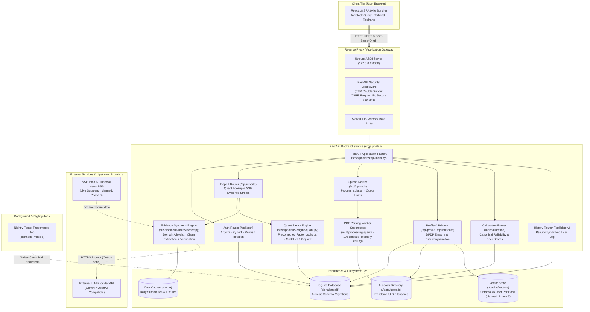
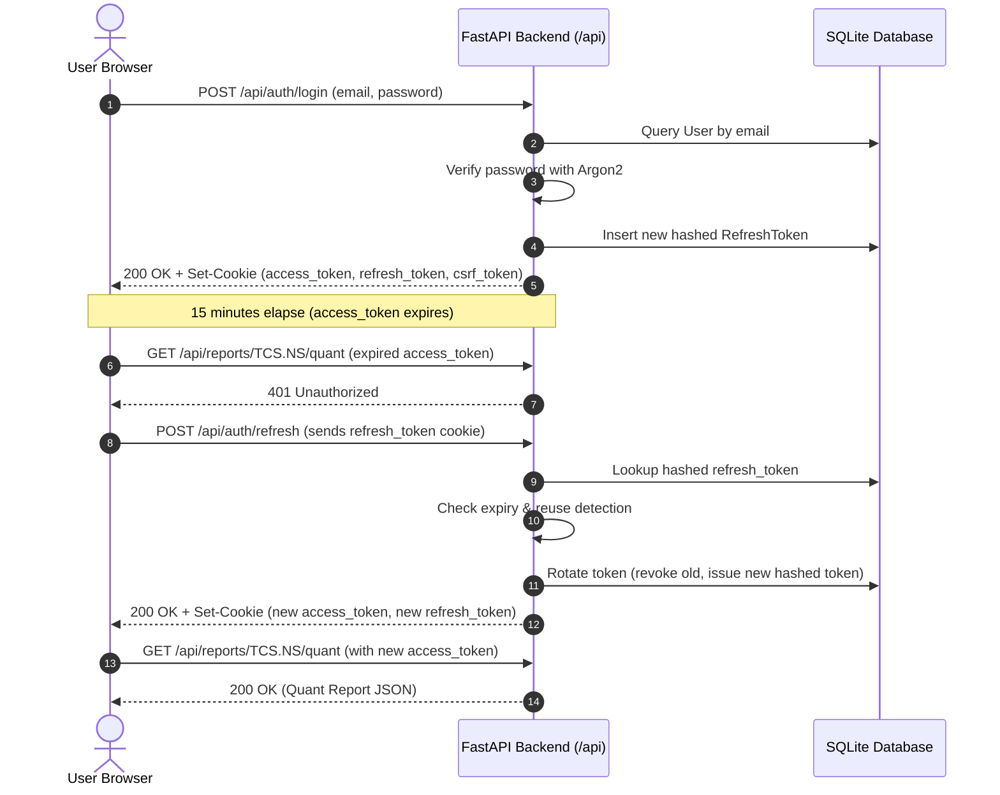
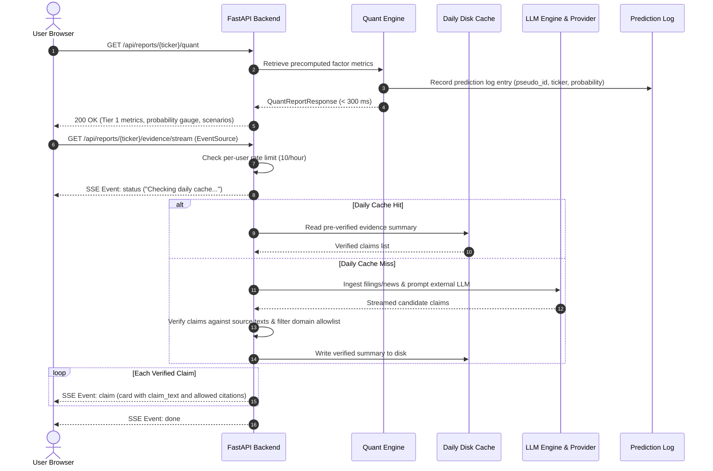
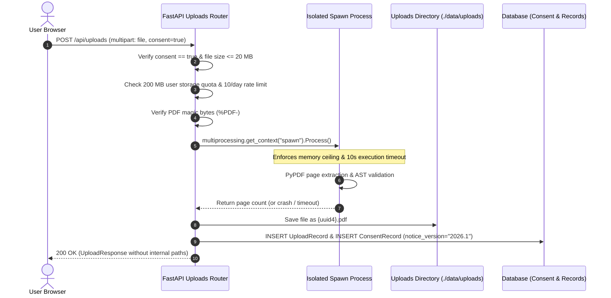
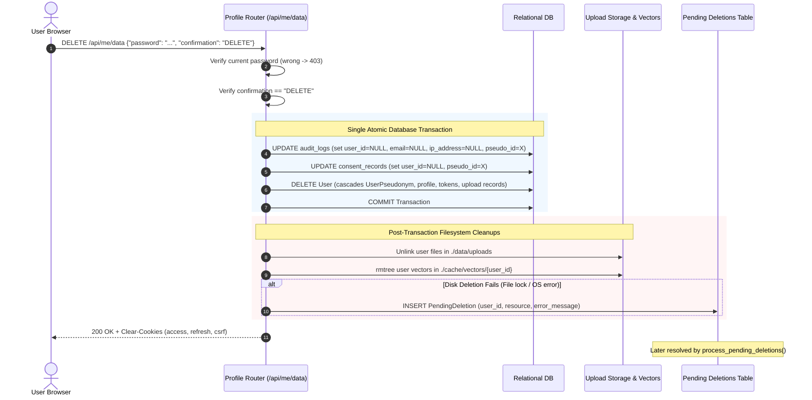
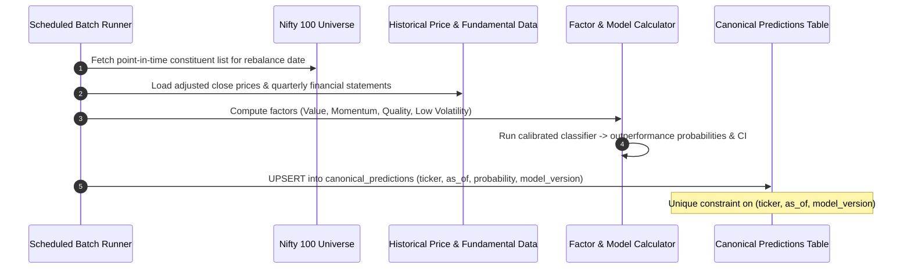

# AlphaLens System Architecture & Technical Design

---

## 1. Purpose

AlphaLens is an evidence-cited, empirically calibrated equity research platform designed specifically for the National Stock Exchange of India (NSE). Its core quantitative objective is evaluating $P(\text{stock's 6-month total return} > \text{Nifty 50 total return})$ across the historical constituent universe of the Nifty 100 index ([ADR-001](file:///c:/Users/vishw/Desktop/project/docs/adr/001-scope.md)). 

The central architectural principle governing AlphaLens is a strict decoupling of quantitative evaluation from language model generation: **the calibrated quantitative multi-factor model independently determines all outperformance probabilities and decision labels, while the LLM synthesis pipeline exclusively surfaces, contextualizes, and verifies cited source evidence without altering statistical scores.**

---

## 2. System Context Diagram

---

## 3. Module Map

### Backend Modules (`src/alphalens/`)

| Module / Package | Responsibility | Key Files | Implementation Status |
| :--- | :--- | :--- | :---: |
| `alphalens.api` | Application creation, security headers, request ID, global exception handling, route registration, and SPA static hosting. | [main.py](file:///c:/Users/vishw/Desktop/project/src/alphalens/api/main.py), [security.py](file:///c:/Users/vishw/Desktop/project/src/alphalens/api/security.py), [deps.py](file:///c:/Users/vishw/Desktop/project/src/alphalens/api/deps.py) | **Implemented** |
| `alphalens.api.routes` | REST endpoints for Auth, Reports, Uploads, Calibration, History, Tickers, and Profile. | [auth.py](file:///c:/Users/vishw/Desktop/project/src/alphalens/api/routes/auth.py), [reports.py](file:///c:/Users/vishw/Desktop/project/src/alphalens/api/routes/reports.py), [uploads.py](file:///c:/Users/vishw/Desktop/project/src/alphalens/api/routes/uploads.py), [calibration.py](file:///c:/Users/vishw/Desktop/project/src/alphalens/api/routes/calibration.py), [history.py](file:///c:/Users/vishw/Desktop/project/src/alphalens/api/routes/history.py), [profile.py](file:///c:/Users/vishw/Desktop/project/src/alphalens/api/routes/profile.py), [tickers.py](file:///c:/Users/vishw/Desktop/project/src/alphalens/api/routes/tickers.py) | **Implemented** |
| `alphalens.config` | Pydantic runtime configuration with `.env` loading and `SecretStr` masking. | [config.py](file:///c:/Users/vishw/Desktop/project/src/alphalens/config.py) | **Implemented** |
| `alphalens.logging` | Structured JSON logging using structlog with automatic key redactor for sensitive tokens. | [logging.py](file:///c:/Users/vishw/Desktop/project/src/alphalens/logging.py) | **Implemented** |
| `alphalens.db` | SQLAlchemy 2.0 ORM models, session factories, and database connection lifecycle. | [models.py](file:///c:/Users/vishw/Desktop/project/src/alphalens/db/models.py), [session.py](file:///c:/Users/vishw/Desktop/project/src/alphalens/db/session.py) | **Implemented** |
| `alphalens.data` | Safe HTTP client (SSRF-hardened), disk caching, Pydantic schemas, universe catalog, price/benchmark fetchers, and sandboxed PDF parsing. | [http.py](file:///c:/Users/vishw/Desktop/project/src/alphalens/data/http.py), [cache.py](file:///c:/Users/vishw/Desktop/project/src/alphalens/data/cache.py), [prices.py](file:///c:/Users/vishw/Desktop/project/src/alphalens/data/prices.py), [benchmark.py](file:///c:/Users/vishw/Desktop/project/src/alphalens/data/benchmark.py), [universe.py](file:///c:/Users/vishw/Desktop/project/src/alphalens/data/universe.py), [pdf_parser.py](file:///c:/Users/vishw/Desktop/project/src/alphalens/data/pdf_parser.py) | **Implemented** |
| `alphalens.engine` | Loaded logistic model calibrator, Monte Carlo scenario simulation (10,000 paths), factor contributions, and prediction logging. | [quant.py](file:///c:/Users/vishw/Desktop/project/src/alphalens/engine/quant.py) | **Implemented** |
| `alphalens.llm` | Evidence streaming, daily disk caching, claim extraction, and domain allowlist filtering. | [evidence.py](file:///c:/Users/vishw/Desktop/project/src/alphalens/llm/evidence.py) | **Implemented** |
| `alphalens.factors` | Pure point-in-time quantitative price factors (mom_12_1, mom_6, rev_1m, vol_6m, mdd_12m, rel_strength_6m), cross-sectional z-scores, and forward return labels. | [price_factors.py](file:///c:/Users/vishw/Desktop/project/src/alphalens/factors/price_factors.py), [labels.py](file:///c:/Users/vishw/Desktop/project/src/alphalens/factors/labels.py), [dataset.py](file:///c:/Users/vishw/Desktop/project/src/alphalens/factors/dataset.py) | **Implemented** |
| `alphalens.backtest` | Walk-forward cross-validation engine with strict embargo protocol, metrics suite (Brier, BSS, Log Loss, ROC AUC, calibration curve, quintile spread). | [walk_forward.py](file:///c:/Users/vishw/Desktop/project/src/alphalens/backtest/walk_forward.py), [metrics.py](file:///c:/Users/vishw/Desktop/project/src/alphalens/backtest/metrics.py) | **Implemented** |

### Frontend Modules (`frontend/src/`)

| Module / Package | Responsibility | Key Files | Implementation Status |
| :--- | :--- | :--- | :---: |
| `frontend/src/api` | Fetch wrapper (`apiFetch`) enforcing same-origin credentials, CSRF headers, and token refresh. OpenAPI TypeScript types. | [client.ts](file:///c:/Users/vishw/Desktop/project/frontend/src/api/client.ts), [schema.d.ts](file:///c:/Users/vishw/Desktop/project/frontend/src/api/schema.d.ts) | **Implemented** |
| `frontend/src/components` | Reusable UI components: Tier 1 Quant display, Tier 2 SSE Evidence panel, Factor bar chart, Protected routes, and skeleton loaders. | [QuantTier.tsx](file:///c:/Users/vishw/Desktop/project/frontend/src/components/QuantTier.tsx), [EvidenceTier.tsx](file:///c:/Users/vishw/Desktop/project/frontend/src/components/EvidenceTier.tsx), [FactorChart.tsx](file:///c:/Users/vishw/Desktop/project/frontend/src/components/FactorChart.tsx), [ProtectedRoute.tsx](file:///c:/Users/vishw/Desktop/project/frontend/src/components/ProtectedRoute.tsx), [SkeletonLoader.tsx](file:///c:/Users/vishw/Desktop/project/frontend/src/components/SkeletonLoader.tsx) | **Implemented** |
| `frontend/src/hooks` | React authentication context and session hooks. | [useAuth.tsx](file:///c:/Users/vishw/Desktop/project/frontend/src/hooks/useAuth.tsx), [useAuthContext.ts](file:///c:/Users/vishw/Desktop/project/frontend/src/hooks/useAuthContext.ts) | **Implemented** |
| `frontend/src/pages` | Top-level routed views: Dashboard (search), Report, Login, Register, Upload, History, Settings, and Calibration. | [Dashboard.tsx](file:///c:/Users/vishw/Desktop/project/frontend/src/pages/Dashboard.tsx), [Report.tsx](file:///c:/Users/vishw/Desktop/project/frontend/src/pages/Report.tsx), [Upload.tsx](file:///c:/Users/vishw/Desktop/project/frontend/src/pages/Upload.tsx), [History.tsx](file:///c:/Users/vishw/Desktop/project/frontend/src/pages/History.tsx), [Settings.tsx](file:///c:/Users/vishw/Desktop/project/frontend/src/pages/Settings.tsx), [Calibration.tsx](file:///c:/Users/vishw/Desktop/project/frontend/src/pages/Calibration.tsx) | **Implemented** |

---

## 4. Dependency Rules & Architectural Invariants

### Architectural Invariants
1. `api/` may import from `engine/`, `db/`, `llm/`, and `data/` services.
2. `engine/` and `factors/` must be pure computation libraries: they must have zero dependencies on network libraries (`httpx`, `requests`), LLM models, or web presentation frameworks.
3. `llm/` must **never** import `engine/`: the generative pipeline cannot modify, influence, or compute numerical prediction probabilities.
4. `data/` ingestion fetchers must never import from `api/`.
5. Frontend components must communicate strictly through `apiFetch` using generated types from `schema.d.ts`.

### Known Architectural Deviations
- **Direct Database Access in Quant Engine**: [src/alphalens/engine/quant.py](file:///c:/Users/vishw/Desktop/project/src/alphalens/engine/quant.py#L6-L8) currently imports `sqlalchemy.orm.Session` and models (`PredictionLog`, `UserPseudonym`) to write prediction log entries within `get_precomputed_quant_score`. *Target Architecture*: Factor computation must be isolated into a pure calculator; audit persistence should reside strictly within an API service layer.
- **FastAPI Exception Coupling in Data Layer**: [src/alphalens/data/pdf_parser.py](file:///c:/Users/vishw/Desktop/project/src/alphalens/data/pdf_parser.py#L8) directly raises `fastapi.HTTPException(422)`. *Target Architecture*: The parsing utility should raise domain exceptions (e.g. `PDFTimeoutError`, `PDFCorruptedError`), mapped to HTTP status codes by API route handlers.

---

## 5. Key Architecture Flows

### Flow A: Authentication, Expiration & Automatic Refresh

### Flow B: Two-Tier Stock Report Generation

### Flow C: Process-Isolated Document Upload

### Flow D: Delete-My-Data Privacy Flow

### Flow E: Nightly Factor Precompute Job *(Planned: Phase 6)*

---

## 6. Data Model & Database Schema

All database models use SQLAlchemy 2.0 Declarative mapping with type annotations:

| Table Name | Purpose | Key Columns | Retention Policy | Contains PII |
| :--- | :--- | :--- | :--- | :---: |
| `users` | User authentication and role accounts. | `id` (UUID PK), `email` (Unique), `password_hash`, `role` (enum: user, admin), `created_at` | Active until user deletion | **Yes** (`email`) |
| `user_pseudonyms` | Bridge decoupling user identity from historical analytics. | `user_id` (FK $\to$ `users.id`), `pseudo_id` (UUID Unique) | Dropped on account deletion | **No** (Surrogate) |
| `refresh_tokens` | Hashed active and revoked refresh tokens. | `id` (UUID PK), `user_id` (FK), `token_hash` (Unique), `expires_at`, `revoked` | 7-day TTL; dropped on logout/deletion | **No** |
| `user_profiles` | Personalized risk tolerances and sector exclusions. | `id` (UUID PK), `user_id` (FK Unique), `risk_level`, `investment_horizon_months`, `sector_exclusions` (JSON) | Active until account deletion | **No** |
| `upload_records` | Metadata tracking user-submitted research documents. | `id` (UUID PK), `user_id` (FK), `original_filename`, `stored_filename` (Unique), `file_size_bytes`, `page_count` | Dropped on file/user deletion | **Low** (Filename) |
| `consent_records` | Immutable legal proof of DPDP Act consent. | `id` (UUID PK), `user_id` (FK, nullable), `pseudo_id` (nullable), `notice_version`, `consent_given_at` | Permanent audit record (pseudonymised) | **No** (after deletion) |
| `prediction_logs` | Append-only historical log of predictions served to users. | `id` (UUID PK), `pseudo_id` (UUID, indexed), `ticker`, `probability`, `decision_label`, `outcome`, `model_version`, `created_at` | Permanent append-only audit trail | **No** |
| `canonical_predictions`| Authoritative benchmark prediction registry for calibration. | `id` (UUID PK), `ticker`, `as_of`, `probability`, `outcome`, `model_version`, `created_at` | Permanent immutable model record | **No** |
| `audit_logs` | Security event trail (logins, logouts, registration). | `id` (UUID PK), `user_id` (nullable), `pseudo_id` (nullable), `email` (nullable), `ip_address` (nullable), `action`, `created_at` | Permanent audit log (sanitized on deletion) | **No** (after deletion) |
| `pending_deletions` | Resilient recovery queue for failed filesystem cleanups. | `id` (UUID PK), `user_id`, `resource_type`, `resource_identifier`, `error_message`, `retry_count` | Purged upon successful retry cleanup | **No** |

---

## 7. Configuration Reference (`Settings`)

Configuration is managed via Pydantic `BaseSettings` reading from `.env` with `extra="forbid"`:

| Setting Parameter | Environment Variable | Default Value | Secret? | Description |
| :--- | :--- | :--- | :---: | :--- |
| `app_env` | `APP_ENV` | `"dev"` | No | Environment runtime tier (`dev`, `test`, `prod`). Disables `/docs` and enables HSTS in `prod`. |
| `log_level` | `LOG_LEVEL` | `"INFO"` | No | Logging verbosity (`DEBUG`, `INFO`, `WARNING`, `ERROR`). |
| `database_url` | `DATABASE_URL` | `"sqlite:///./alphalens.db"` | No | SQLAlchemy database connection string. |
| `cache_dir` | `CACHE_DIR` | `Path("./cache")` | No | Directory for factor disk caches and vector collections. |
| `upload_dir` | `UPLOAD_DIR` | `Path("./data/uploads")` | No | Isolated filesystem directory for stored research PDFs. |
| `jwt_secret_key` | `JWT_SECRET_KEY` | *(Insecure dev placeholder)* | **Yes** | 256-bit secret key used to sign HS256 access tokens. |
| `jwt_algorithm` | `JWT_ALGORITHM` | `"HS256"` | No | Cryptographic signature algorithm for JWT tokens. |
| `access_token_expire_minutes` | `ACCESS_TOKEN_EXPIRE_MINUTES` | `15` | No | Lifespan of short-lived JWT access tokens. |
| `refresh_token_expire_days` | `REFRESH_TOKEN_EXPIRE_DAYS` | `7` | No | Lifespan of persistent refresh tokens. |
| `allowed_evidence_domains` | `ALLOWED_EVIDENCE_DOMAINS` | `["bseindia.com", "nseindia.com", ...]` | No | Strict allowlist of domains permitted in LLM citation links. |
| `llm_provider` | `LLM_PROVIDER` | `"openai_compatible"` | No | LLM inference gateway driver. |
| `llm_base_url` | `LLM_BASE_URL` | `None` | No | Base endpoint for OpenAI-compatible LLM provider. |
| `llm_model` | `LLM_MODEL` | `None` | No | Specific model identifier string. |
| `llm_api_key` | `LLM_API_KEY` | `None` | **Yes** | Authentication bearer token for the external LLM provider. |

---

## 8. Performance Design & SLA Targets

| Target SLA / Metric | ADR-002 Design Target | Current Implementation & Mechanism |
| :--- | :---: | :--- |
| **Initial Bundle Budget** | $< 200\text{ KB}$ gzipped | **81.91 KB** gzipped (Enforced via `size-limit` in frontend build pipeline). |
| **Quant Result Latency** | $< 300\text{ ms}$ | **$< 50\text{ ms}$** (Instant precomputed dictionary and database lookup; no live LLM or web queries). |
| **Full Report Streaming** | $< 15\text{ s}$ total | **Progressive streaming** via SSE (`sse-starlette`); claims emit as verified; EventSource closes on unmount. |
| **PDF Parser Timeout** | $\le 10\text{ s}$ | Hard 10s timeout enforced via `process.join(timeout=10)` in an isolated spawn process. |

---

## 9. Architectural Decision Records (ADRs)

- **[ADR-001: Market, prediction target, and universe](file:///c:/Users/vishw/Desktop/project/docs/adr/001-scope.md)**: Defines market as India (NSE), target as $P(\text{6-month return} > \text{Nifty 50})$, universe as historical Nifty 100 constituents, and sets forward-only evaluation for LLMs to prevent look-ahead bias.
- **[ADR-002: React (Vite) frontend + FastAPI backend](file:///c:/Users/vishw/Desktop/project/docs/adr/002-frontend.md)**: Establishes a unified same-origin architecture where FastAPI serves static Vite assets at `/` and REST endpoints at `/api`, eliminating CORS and enabling strict `HttpOnly` cookie security.

---

## 10. Technical Debt & Known Limitations

1. **In-Memory SlowAPI Rate Limiting**: Rate limits use default `MemoryStorage`. In multi-worker or containerized deployments, limits are not shared across processes. Migration to Redis is scheduled for Phase 4.
2. **Process Resource Limits Platform Support**: `resource.setrlimit(RLIMIT_AS)` is POSIX/Linux-only; it executes as a no-op on Windows development machines, relying strictly on process termination timeouts.
3. **Mock Evidence Synthesis**: The LLM evidence pipeline currently serves verified fixture claims pending full live integration of external LLM API endpoints in Phase 3.
