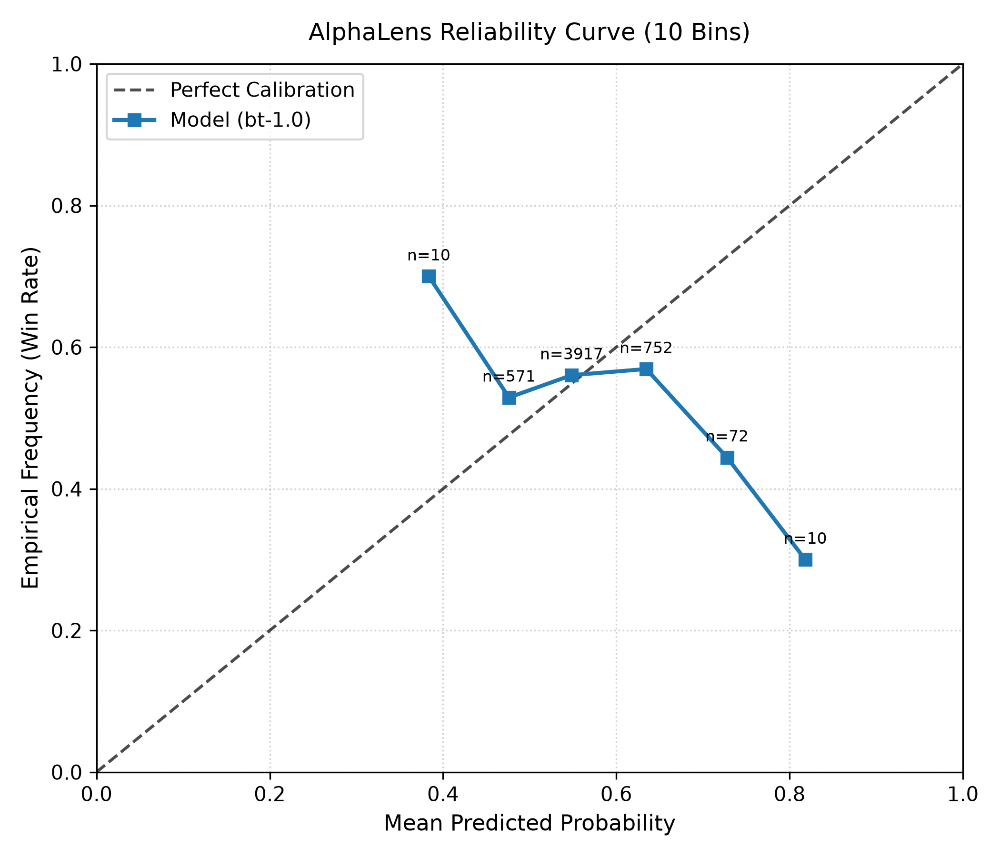
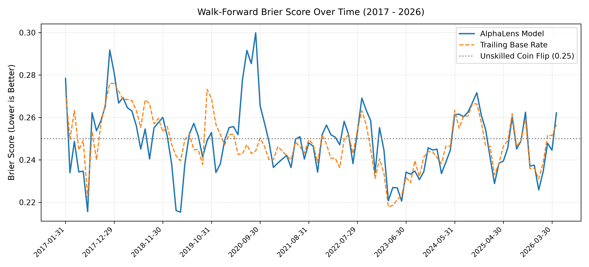
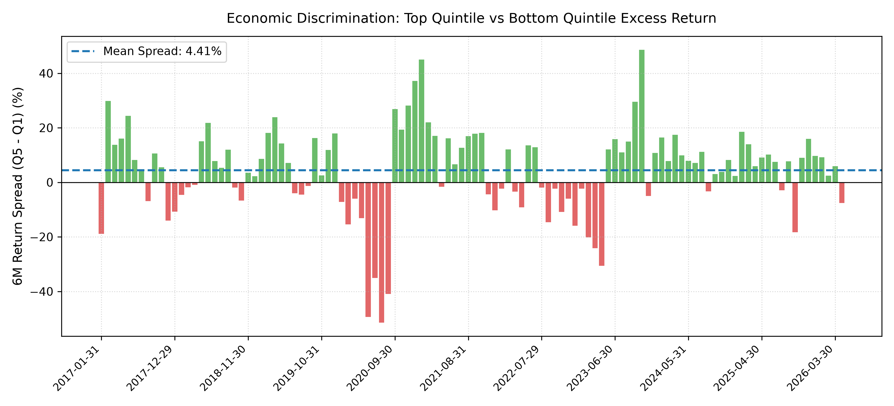

# AlphaLens Quantitative Research & Walk-Forward Backtest Results

---

## 1. Research Scope & Evaluation Methodology

Per [ADR-001](file:///c:/Users/vishw/Desktop/project/docs/adr/001-scope.md) and [ADR-003](file:///c:/Users/vishw/Desktop/project/docs/adr/003-price-and-benchmark-data.md), AlphaLens evaluates the predictive capability of a point-in-time quantitative factor model on Indian equities:

- **Market**: National Stock Exchange of India (NSE).
- **Target Variable**: Binary outperformance indicator over a 126-trading-day (~6 calendar months) forward horizon:
  $$\text{excess\_6m} = \text{Total Return}_{\text{stock}}(t \to t+126\text{d}) - \text{Total Return}_{\text{benchmark}}(t \to t+126\text{d})$$
  $$\text{label} = \begin{cases} 1 & \text{if } \text{excess\_6m} > 0 \\ 0 & \text{otherwise} \end{cases}$$
- **Benchmark**: Nifty 50 Total Returns Index (TRI).
- **Universe**: Nifty 50 constituent equities (`50` stocks mapped to `SYMBOL.NS`).
- **Evaluation Cadence**: Monthly rebalancing at month-end dates from `2017-01-31` to `2026-11-12` (**119 distinct monthly folds**).

---

## 2. Factor Suite & Preprocessing

At each rebalance date $t$, six pure price and risk factors are computed strictly using price history $\le t$:

1. `mom_12_1`: 12-minus-1 month return ($P_{t-21\text{d}} / P_{t-252\text{d}} - 1$).
2. `mom_6`: 6-month momentum return ($P_t / P_{t-126\text{d}} - 1$).
3. `rev_1m`: 1-month short-term reversal ($P_t / P_{t-21\text{d}} - 1$).
4. `vol_6m`: Annualized standard deviation of daily returns over the past 126 trading days ($\sigma_{\text{daily}} \times \sqrt{252}$).
5. `mdd_12m`: Maximum drawdown over the trailing 252 trading days ($\min(P / \text{Peak} - 1)$).
6. `rel_strength_6m`: Stock 6-month return minus benchmark 6-month return.

### Cross-Sectional Normalization
To prevent look-ahead bias and distributional drift, raw factors are z-scored **per rebalance date**:
$$z_{i, t} = \frac{f_{i, t} - \mu_t}{\sigma_t}$$
Winsorized at $\pm 3.0$ standard deviations to limit outlier distortion.

---

## 3. Strict Walk-Forward Embargo Protocol

Standard $k$-fold cross-validation or unconstrained rolling regressions leak future information when labels span overlapping forward windows. AlphaLens implements a **strict embargo rule**:

- At rebalance date $t$, the training set includes **only** observations where:
  $$\text{label is not None} \quad \text{AND} \quad \text{label\_end\_date} \le t$$
- Since labels require 126 trading days (~6 months) to resolve, observations from $t - 6\text{m}$ to $t$ are under active evaluation and strictly omitted from model training.
- Zero future or overlapping data enters the parameter fitting step.

---

## 4. Empirical Evaluation Results

All metrics below are drawn strictly from [reports/backtest/results.json](file:///c:/Users/vishw/Desktop/project/reports/backtest/results.json), evaluated across the **identical common sample** of $N = 5,332$ resolved predictions ($112$ rebalance months):

### Summary Metrics Table (Common Sample $N = 5,332$)

| Metric | AlphaLens Model (6 Factors) | Momentum Baseline (`mom_12_1`) | Trailing Base Rate Baseline |
| :--- | :---: | :---: | :---: |
| **Brier Score** (lower is better) | **0.2492** | 0.2482 | 0.2479 |
| **Brier Skill Score (BSS)** vs Base Rate | **-0.0051** | -0.0009 | 0.0000 |
| **Log Loss** | **0.6920** | 0.6896 | 0.6891 |
| **ROC AUC** | **0.5142** | 0.5055 | N/A\* |
| **Top vs Bottom Quintile Spread (6M Excess)** | **+4.41%** | +3.78% | N/A |
| **Spread $t$-statistic (Naive)** | **$t = 2.84$** ($p = 0.0054$) | $t = 2.90$ ($p = 0.0045$) | N/A |
| **Spread $t$-statistic (Newey-West HAC, lag 5)** | **$t = 1.79$** ($p = 0.0761$) | $t = 1.62$ ($p = 0.1071$) | N/A |
| **Spread Standard Deviation** | **0.1644** | 0.1381 | N/A |
| **Common Sample Predictions (Resolved)** | **5,332** | 5,332 | 5,332 |
| **Evaluated Months** | **112** (resolved) / 119 (total) | 112 | 112 |

\* *Footnote on Base-Rate Baseline ROC AUC: The base-rate baseline assigns the trailing empirical historical win rate to all stocks at each date $t$. Because the prediction is constant across all assets within each cross-section, it cannot rank stocks relative to one another, making ROC AUC undefined / non-applicable (N/A).*

---

## 5. Visualizations & Diagnostic Analysis

### Empirical Calibration & Reliability Curve

#### Reliability Table (10 Probability Bins)
| Bin Center | Mean Predicted Probability | Observed Win Rate | Sample Count ($n$) |
| :---: | :---: | :---: | :---: |
| 0.05 | 0.0500 | 0.0000 | 0 |
| 0.15 | 0.1500 | 0.0000 | 0 |
| 0.25 | 0.2500 | 0.0000 | 0 |
| 0.35 | 0.3835 | 0.7000 | 10 |
| 0.45 | 0.4761 | 0.5289 | 571 |
| 0.55 | 0.5484 | 0.5604 | 3,917 |
| 0.65 | 0.6345 | 0.5691 | 752 |
| 0.75 | 0.7277 | 0.4444 | 72 |
| 0.85 | 0.8181 | 0.3000 | 10 |
| 0.95 | 0.9500 | 0.0000 | 0 |

### Brier Score Trajectory Over Time

### Economic Discrimination (Quintile Spread)

---

## 6. Interpretation of Results

1. **Probabilistic Calibration:**
   - The predicted probabilities display **no calibration skill beyond the trailing base rate** ($BSS = -0.0051 \approx 0.0$). The Brier score (0.2492) and log loss (0.6920) are indistinguishable from simply forecasting the unconditional historical base rate (0.2479 and 0.6891).
   - Consequently, the model's output probabilities must not be interpreted as absolute physical probabilities, but rather as relative cross-sectional ranking scores.
2. **Incremental Factor Value:**
   - The 6-factor model adds very little incremental value over simple single-factor momentum (`mom_12_1`): Brier scores are nearly identical (0.2492 vs 0.2482), ROC AUC is only marginally higher (0.5142 vs 0.5055), and the average monthly quintile return spread is +4.41% compared to +3.78% for momentum alone.
3. **Statistical Significance After HAC Adjustment:**
   - Under naive standard errors assuming independent observations, the quintile spread appears statistically significant at $t = 2.84$ ($p = 0.0054$).
   - However, because the forward 6-month return evaluation windows overlap across monthly rebalance dates, returns exhibit serial autocorrelation.
   - Adjusting for this autocorrelation using the Newey-West HAC estimator with lag 5, the standard error widens from 0.0155 to 0.0246, reducing the $t$-statistic to **$t = 1.79$ ($p = 0.0761$)** for the 6-factor model and **$t = 1.62$ ($p = 0.1071$)** for the momentum baseline.
   - The ranking spread is therefore only marginally significant at the 10% level and fails to achieve statistical significance at the standard 5% level ($p < 0.05$).

