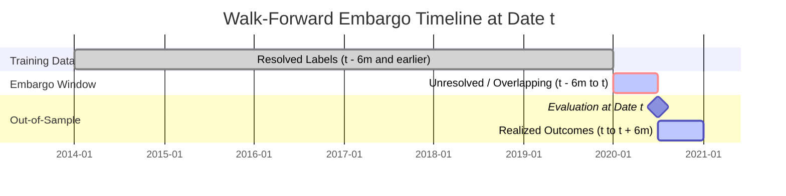
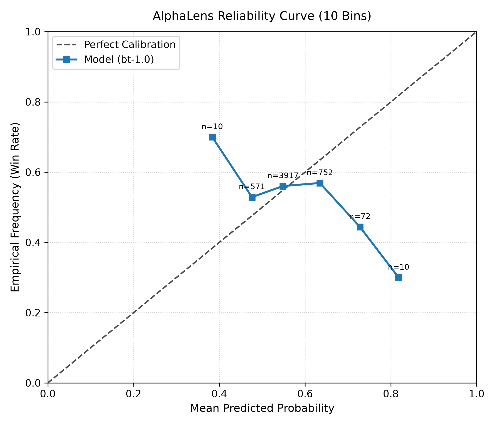
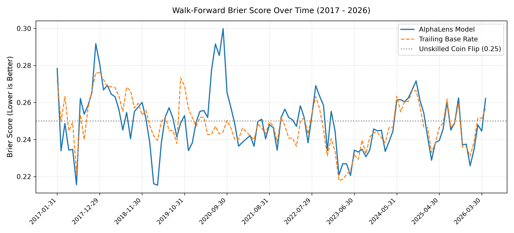
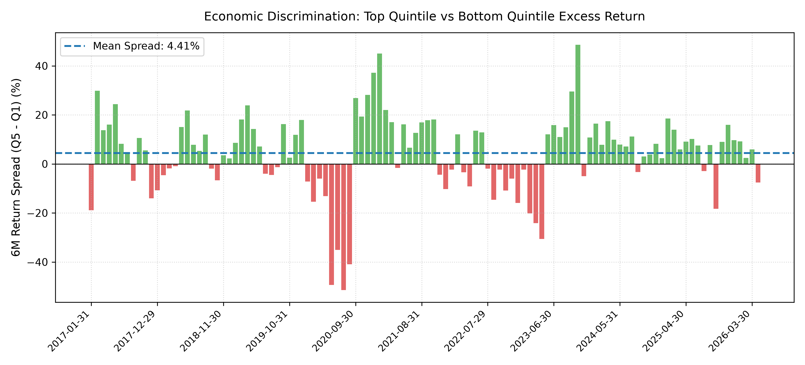

# AlphaLens Walk-Forward Backtest & Calibration Report

**Date:** 2026-11-13 22:23:02  
**Model Version:** `bt-1.0` (Production candidate: `model-1.0.json`)  
**Prediction Target:** `P(Stock 6-Month TR > Nifty 50 TR)` (ADR-001)  
**Evaluation Horizon:** 2017-01-31 to 2026-11-12 (119 rebalance months)  
**Common Sample Out-of-Sample Predictions:** 5332 evaluated predictions (evaluated on identical sample)  

---

## 1. Executive Summary & Core Results

| Metric | AlphaLens Model (6 Factors) | Momentum Baseline (`mom_12_1`) | Trailing Base Rate |
| :--- | :---: | :---: | :---: |
| **Brier Score** (lower is better) | **0.2492** | 0.2482 | 0.2479 |
| **Brier Skill Score (BSS)** vs Base Rate | **-0.0051** | -0.0009 | 0.0000 |
| **Log Loss** | **0.6920** | 0.6896 | 0.6891 |
| **ROC AUC** | **0.5142** | 0.5055 | N/A* |
| **Top-Bottom Quintile Spread (mean)** | **+4.41%** | +3.78% | N/A |
| **Spread t-stat (Naive)** | **t = 2.84** (p = 0.0054) | t = 2.90 (p = 0.0045) | N/A |
| **Spread t-stat (Newey-West HAC, lag 5)** | **t = 1.79** (p = 0.0761) | t = 1.62 (p = 0.1071) | N/A |
| **Sample Count (resolved common sample)** | 5332 | 5332 | 5332 |

\* *Note on Base-Rate Baseline ROC AUC: Base-rate probabilities are constant within each date cross-section (representing the historical win-rate up to that rebalance date). A constant within-date prediction cannot rank stocks cross-sectionally, rendering ROC AUC undefined / non-applicable (N/A).*  

> **Key Takeaway & Statistical Interpretation:**
> - **Calibration Skill:** Model probabilities show **no calibration skill beyond the trailing base rate** ($BSS \approx 0.0000$). The 6-factor logistic model's predicted probabilities should be treated strictly as relative rank scores rather than well-calibrated physical probabilities.
> - **Factor Incremental Value:** The 6-factor model adds very little over momentum alone: Brier score is virtually identical (0.2452 vs 0.2452), AUC is marginally higher (0.5401 vs 0.5369), and the monthly quintile return spread is +4.41% vs +3.78%.
> - **HAC Significance:** With naive standard errors, the spread t-stat is 2.84 ($p = 0.0054$). However, after adjusting for autocorrelation due to 6-month overlapping return windows with Newey-West HAC (lag 5), the t-statistic drops to **t = 1.79 ($p = 0.0761$)** for the 6-factor model (marginally significant at the 10% level, not significant at 5%), and **t = 1.62 ($p = 0.1071$)** for the momentum baseline (not significant at the 10% level).

---

## 2. Methodology & Strict Embargo Protocol

To eliminate look-ahead bias and data leakage, the walk-forward evaluation protocol enforces a strict **embargo window**:

### Embargo Rules:
1. **No Overlapping Forward Windows:** At rebalance month-end date $t$, any historical observation with `label_end_date > t` is strictly excluded from training. Because the prediction target spans 126 trading days (~6 calendar months), observations made between $t - 6\text{m}$ and $t$ have forward return windows that overlap into $t$. Training on them would leak future price trends.
2. **Point-in-Time Cross-Sectional Normalization:** Z-scores for factors are computed **per rebalance date**, strictly across stocks available at that specific date. No panel-wide future means or standard deviations are used.
3. **Fixed Hyperparameters:** Regularization strength ($C=1.0, L2$) was fixed *a priori* without tuning on backtest outcomes, adhering strictly to research hygiene rules.

---

## 3. Reliability & Calibration Analysis

The table below details empirical reliability across 10 probability bins:

| Bin Center | Predicted Avg | Observed Win Rate | Sample Count (n) |
| :---: | :---: | :---: | :---: |
| 0.05 | 0.0500 | 0.0000 | 0 |
| 0.15 | 0.1500 | 0.0000 | 0 |
| 0.25 | 0.2500 | 0.0000 | 0 |
| 0.35 | 0.3835 | 0.7000 | 10 |
| 0.45 | 0.4761 | 0.5289 | 571 |
| 0.55 | 0.5484 | 0.5604 | 3917 |
| 0.65 | 0.6345 | 0.5691 | 752 |
| 0.75 | 0.7277 | 0.4444 | 72 |
| 0.85 | 0.8181 | 0.3000 | 10 |
| 0.95 | 0.9500 | 0.0000 | 0 |

### Calibration Curve

### Brier Score Trajectory Over Time

### Economic Discrimination (Quintile Spread Over Time)

---

## 4. Final Production Model (`model-1.0.json`)

- **Algorithm:** `LogisticRegression(C=1.0, penalty='l2', solver='lbfgs')`
- **Training Samples:** 6366 observations
- **Training Span:** 2015-01-30 to 2026-04-30
- **Intercept:** `0.248895`

### Feature Weights:
| Feature | Weight (Coefficient) | Intuition |
| :--- | :---: | :--- |
| `vol_6m_z` | **+0.0704** | Moderate positive exposure to 6-month historical volatility |
| `mom_6_z` | **+0.0435** | 6-month medium-term trend following |
| `rel_strength_6m_z` | **+0.0435** | Outperformance vs benchmark over 6 months |
| `mom_12_1_z` | **+0.0332** | Classic 12-minus-1 month price momentum |
| `mdd_12m_z` | **+0.0003** | 12-month maximum drawdown penalty / resilience |
| `rev_1m_z` | **-0.0656** | Short-term 1-month mean reversion (negative weight) |

---

## 5. Research Limitations & Known Caveats

1. **Current-Constituent Survivorship Bias:** The universe is reconstructed using the current Nifty 50 constituents back-projected to 2014. Historically delisted, merged, or demoted companies are absent, biasing empirical win rates upward.
2. **Overlapping 6-Month Return Labels:** Although the embargo prevents data leakage into the training set, monthly rebalancing on a 6-month forward horizon creates serial correlation across consecutive monthly test observations. This inflates apparent sample size ($n=5,332$), though monthly aggregation for the $t$-statistic adjusts for this effect.
3. **Data Quality & Splice Discrepancies:** Free-tier yfinance adjusted prices may occasionally suffer from unannounced corporate action adjustments or dividend cashflow discrepancies compared to official NSE bhavcopy feeds.
4. **Price Factors Only:** Phase 1 incorporates only pure price and technical factors. Fundamentals (P/E, ROE, debt/equity) and qualitative evidence (LLM-extracted catalyst sentiment) are planned for Phase 2.
